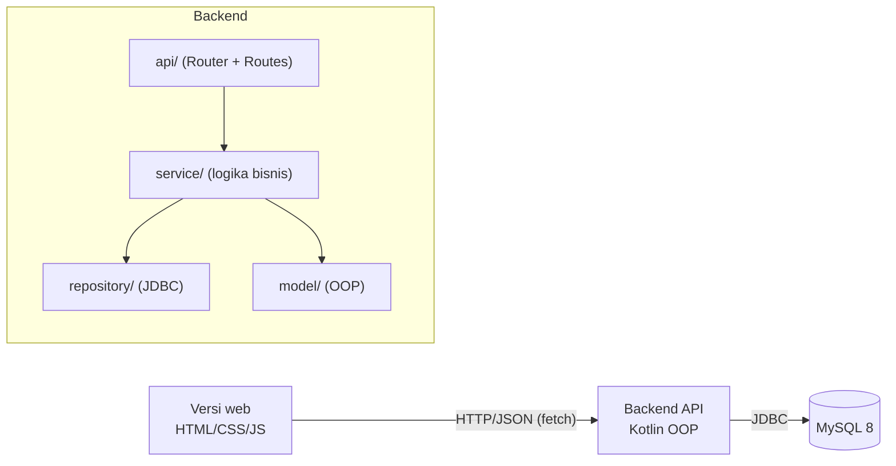
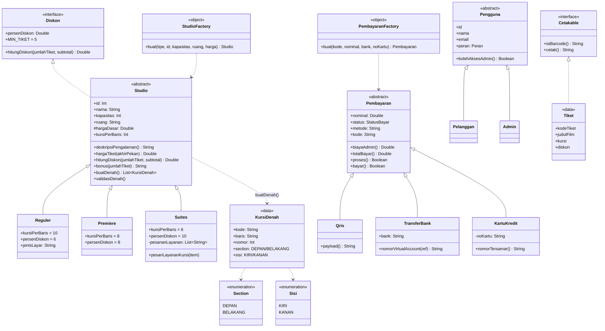
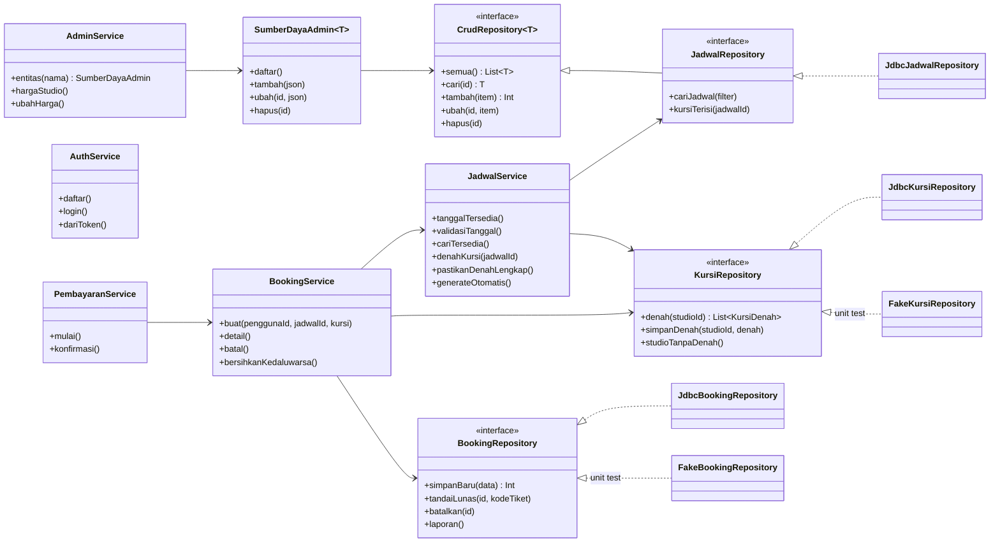
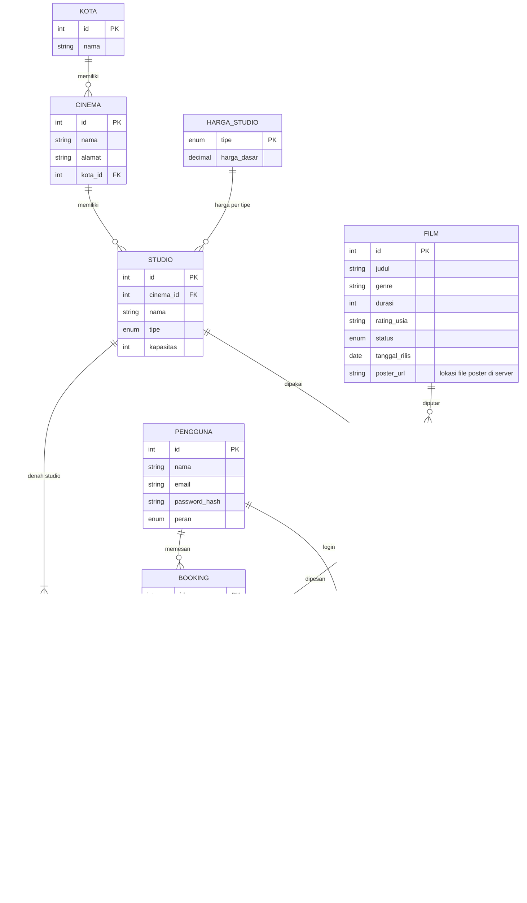

# Class Diagram, ERD, dan Arsitektur

GitHub merender diagram Mermaid di bawah ini secara otomatis.

## Arsitektur

## Class diagram domain (model/)

## Class diagram service & repository

## ERD (MySQL, 11 tabel)

## Peta konsep OOP
| Konsep | Penerapan |
|---|---|
| Abstract class | `Studio`, `Pembayaran`, `Pengguna` |
| Inheritance | `Reguler/Premiere/Suites`, `Qris/TransferBank/KartuKredit`, `Pelanggan/Admin` |
| Polymorphism | `hargaTiket()`, `persenDiskon`/`hitungDiskon()`, `kursiPerBaris`, `bonus()` per studio; `biayaAdmin()`/`proses()` per pembayaran |
| Interface | `Diskon` (diimplementasikan `Studio`), `Cetakable`, `CrudRepository<T>`, `KursiRepository`, dll. |
| Encapsulation | `status` bayar hanya berubah lewat `bayar()`; `pesananLayanan` Suites `private` |
| Data class | `Film`, `Cinema`, `Jadwal`, `Kursi`, `KursiDenah`, `Tiket`, `BookingDetail` |
| Enum | `TipeStudio`, `Section`, `Sisi`, `StatusBayar` |
| Generics | `CrudRepository<T>`, `SumberDayaAdmin<T, F>` |
| Factory | `StudioFactory`, `PembayaranFactory`, `PenggunaFactory` |
| Custom exception | `KursiSudahDipesanException`, `HariTidakValidException`, `PembayaranGagalException`, `DataTidakDitemukanException` |
