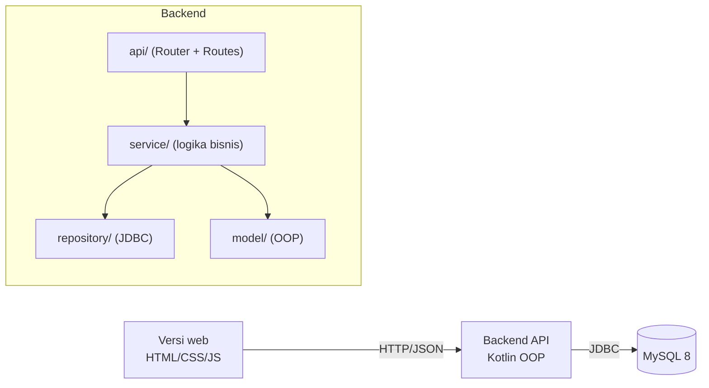
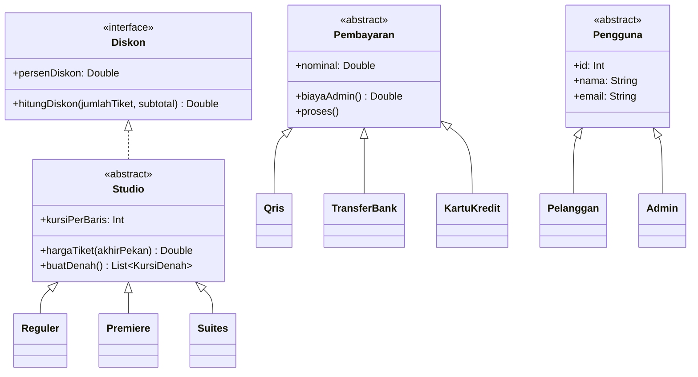
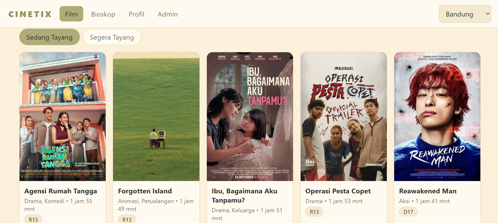

# Cinetix — Aplikasi Reservasi Bioskop

## Deskripsi
Cinetix adalah aplikasi web untuk melakukan pemesanan tiket bioskop. Aplikasi ini menyelesaikan masalah pelanggan yang
harus datang ke loket atau memilih kursi tanpa melihat denah studio, serta risiko dua orang memesan kursi
yang sama. Pelanggan dapat melihat bioskop per kota, memilih jadwal dan kursi dari denah, membayar, lalu
menyimpan e-ticket ber-barcode. Admin bioskop dapat mengelola data dan melihat laporan penjualan.

> ⚠️ **Pembayaran QRIS, transfer bank, dan kartu kredit adalah SIMULASI.**
> Tidak terhubung ke payment gateway. Pelanggan menekan "Saya sudah bayar" untuk mensimulasikan pembayaran berhasil.

## Anggota Kelompok
| Nama | NIM | Peran |
|------|-----|-------|
| Qurrata A'yuni | 225443023 | Project Lead |
| Ajeng Az Zahra | 225443002 | Domain Developer |
| Arlisya Rahwitami | 225443004 | Business Logic |
| Shiva Nayla Zahra | 225443053 | UI (Android) |
| Renisa Rahmawati | 225443025 | QA + Data |
| Nabila Khalishah | 225443021 | DevOps |

## Fitur
- [x] Daftar dan login (pelanggan dan admin)
- [x] Bioskop per kota
- [x] Film Sedang Tayang dan Coming Soon, beserta detail film
- [x] Pilih jadwal (maksimal 3 hari ke depan), lokasi, jam, dan tipe studio (Reguler / Premiere / Suites)
- [x] Pilih kursi dari denah studio (section dekat/jauh layar, jalan tengah, anti double booking)
- [x] Diskon ketika pembelian mencapai 5 tiket (Reguler 6%, Premiere 8%, Suites 10%)
- [x] Pembayaran QRIS, transfer bank (virtual account), dan kartu kredit (simulasi)
- [x] Riwayat pembelian pelanggan
- [x] E-ticket dengan barcode, bisa dicetak atau disimpan sebagai PDF
- [x] Admin: CRUD film, kota, cinema, studio (denah kursi dibuat otomatis), dan jadwal
- [x] Admin: ubah harga tiket dan unggah poster film
- [x] Admin: laporan penjualan dan film terlaris

## Arsitektur
Web hanya berbicara dengan backend lewat HTTP/JSON. Hanya backend yang mengakses MySQL.



Class diagram domain (`model/`):



Diagram lengkap (termasuk ERD): [`docs/02-class-diagram.md`](docs/02-class-diagram.md).
Dokumentasi REST API: [`docs/03-api.md`](docs/03-api.md).

## Struktur folder
```
cinetix/
├── backend/                       # REST API Kotlin + penyaji versi web
│   ├── src/main/kotlin/
│   │   ├── model/                 # entity + abstract class + interface (OOP)
│   │   ├── repository/            # akses MySQL (JDBC), termasuk tabel kursi
│   │   ├── service/               # logika bisnis
│   │   ├── exception/             # custom exception
│   │   ├── util/                  # koneksi DB, QR/barcode, hash password
│   │   ├── api/                   # router + endpoint REST
│   │   └── Main.kt
│   ├── src/main/resources/web/    # VERSI WEB: index.html, style.css, app.js
│   ├── src/test/kotlin/           # unit test (repository palsu, tanpa MySQL)
│   ├── build.gradle.kts
│   └── Dockerfile
├── data/schema.sql, seed.sql      # skema & data awal MySQL (11 tabel)
├── docs/                          # user story, class diagram, API, pembagian tugas
├── docker-compose.yml             # MySQL + backend
└── .github/workflows/ci.yml       # unit test otomatis
```

## Cara Menjalankan
### Lokal
Butuh JDK 17 dan MySQL 8.
```bash
mysql -u root -p < data/schema.sql
mysql -u root -p cinetix < data/seed.sql

cd backend
# Linux/Mac
DB_URL="jdbc:mysql://localhost:3306/cinetix?useSSL=false&allowPublicKeyRetrieval=true" DB_USER=root DB_PASS=passwordmu ./gradlew run --console=plain
# Windows (PowerShell)
$env:DB_URL="jdbc:mysql://localhost:3306/cinetix?useSSL=false&allowPublicKeyRetrieval=true"; $env:DB_USER="root"; $env:DB_PASS="passwordmu"; .\gradlew.bat run --console=plain
```
Lalu buka http://localhost:8080/ di browser.

### Docker
Butuh Docker Desktop.
```bash
docker compose build
docker compose run --rm --service-ports api
```
Atau jalankan di background: `docker compose up -d --build` (cek dengan `docker compose logs -f api`,
tunggu sampai muncul `[OK] CINETIX API berjalan`).

Buka http://localhost:8080/ di browser. Cek API di http://localhost:8080/api (hasil `{"status":"OK"}`).

Akun demo:

| Peran | Email | Password |
|---|---|---|
| Pelanggan | `budi@mail.com` | `budi123` |
| Admin | `admin@cinetix.id` | `admin123` |

Kartu kredit uji (simulasi): `4111 1111 1111 1111`.

Reset database (misalnya setelah mengubah `seed.sql`): `docker compose down -v`, lalu jalankan lagi.

### Menjalankan Test
```bash
cd backend
./gradlew test
```
41 unit test menguji model (harga dan denah tiap studio, diskon 6/8/10%, pembayaran) dan service
(validasi 3 hari, denah per section, double booking + rollback, alur pembayaran) memakai repository palsu,
tanpa MySQL.

## Screenshot
<!-- Simpan tangkapan layar aplikasi di docs/screenshot.png -->


## Teknologi
- Kotlin 2.0.21 (JVM 17)
- Gradle 8.10.2 (wrapper)
- HttpServer bawaan JDK (tanpa framework web)
- MySQL 8 dan JDBC (mysql-connector-j 8.4.0)
- Gson 2.11.0 (JSON)
- ZXing 3.5.3 (QR dan barcode)
- HTML, CSS, JavaScript (tampilan web)
- JUnit 5
- Docker dan Docker Compose
- GitHub Actions

## Lisensi
MIT
