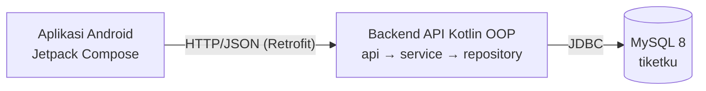

# Cinetix — Aplikasi Reservasi Bioskop

## Deskripsi
Cinetix adalah aplikasi pemesanan tiket bioskop ala CGV untuk pelanggan yang ingin memesan tiket tanpa antre, dan untuk admin bioskop yang perlu mengelola data serta memantau penjualan. Pelanggan dapat melihat bioskop per kota, film Sedang Tayang & Coming Soon, memilih jadwal (maks. 3 hari ke depan) dan studio (Reguler / 4DX / Premiere / Suites), memilih kursi tanpa risiko double booking, memesan F&B + paket bundling, membayar, mendapat cashback, lalu menyimpan e-ticket ber-barcode.

> ⚠️ **Pembayaran QRIS, transfer bank, dan kartu kredit adalah SIMULASI.**
> Tidak terhubung ke payment gateway (Midtrans/Xendit). QR berisi nominal dibuat dengan ZXing, lalu pelanggan menekan "Saya sudah bayar" untuk mensimulasikan pembayaran berhasil.

## Anggota Kelompok
| Nama | NIM | Peran |
|------|-----|-------|
| Qurrata A'yuni | 225443023 | Project Lead |
| Ajeng Az Zahra | 225443002 | Domain Developer |
| Arlisya Rahwitami | 225443004 | Business Logic |
| Shiva Nayla Zahra | 225443053 | UI (Android) |
| Renisa Rahmawati | 225443025 | QA + Data |
| Nabila Khalishah | 225443021 | DevOps |

Rincian kontribusi ada di [CONTRIBUTORS.md](CONTRIBUTORS.md).

## Fitur
**Pelanggan**
- [x] Daftar & login
- [x] Lihat bioskop per kota
- [x] Film Sedang Tayang & Coming Soon + detail film
- [x] Pilih hari (maks. 3 hari), lokasi, jam, dan studio
- [x] Pilih kursi (anti double booking)
- [x] F&B: Popcorn, Sistagor, Cola, Mineral + bundling
- [x] Bayar QRIS (QR otomatis sesuai nominal) / Transfer Bank (VA) / Kartu Kredit
- [x] Cashback
- [x] Riwayat pembelian
- [x] E-ticket + barcode untuk dicetak

**Admin**
- [x] CRUD film, kota, cinema, studio, jadwal, harga studio
- [x] CRUD menu F&B & bundling
- [x] Kelola promo cashback
- [x] Laporan penjualan & film terlaris

## Arsitektur


Aplikasi Android **tidak** terhubung langsung ke MySQL. Semua logika bisnis dan akses database berada di backend.

Diagram lengkap (class diagram & ERD): [docs/02-class-diagram.md](docs/02-class-diagram.md)

### Konsep OOP
| Konsep | Penerapan |
|---|---|
| Abstract class | `Studio`, `Pembayaran`, `MenuFnb`, `Pengguna` |
| Inheritance | `Reguler/FourDX/Premiere/Suites`, `Qris/TransferBank/KartuKredit`, `Makanan/Minuman/Bundling`, `Pelanggan/Admin` |
| Polymorphism | `studio.hargaTiket()`, `pembayaran.biayaAdmin()` & `proses()`, `cashback.hitung()` |
| Interface | `Cashback`, `Cetakable`, `CrudRepository<T>` |
| Encapsulation | stok F&B & saldo cashback `private set`; status bayar hanya berubah lewat `bayar()` |
| Data class | `Film`, `Cinema`, `Jadwal`, `Kursi`, `Tiket` |
| Custom exception | `KursiSudahDipesanException`, `HariTidakValidException`, `PembayaranGagalException`, `StokHabisException` |

## Cara Menjalankan

### Lokal
Butuh JDK 17+ dan MySQL 8.
```bash
mysql -u root -p < data/schema.sql
mysql -u root -p tiketku < data/seed.sql

cd backend
# Linux/Mac
DB_URL="jdbc:mysql://localhost:3306/tiketku?useSSL=false&allowPublicKeyRetrieval=true" DB_USER=root DB_PASS=passwordmu ./gradlew run --console=plain
# Windows (PowerShell)
$env:DB_URL="jdbc:mysql://localhost:3306/tiketku?useSSL=false&allowPublicKeyRetrieval=true"; $env:DB_USER="root"; $env:DB_PASS="passwordmu"; .\gradlew.bat run --console=plain
```

### Docker
Butuh Docker Desktop.
```bash
docker compose up -d --build      # MySQL + backend API
docker compose logs -f api        # tunggu sampai muncul "[OK] TIKETKU API berjalan"
```
Cek di browser: http://localhost:8080/api → `{"status":"OK"}`.
Reset database: `docker compose down -v` lalu `docker compose up -d --build`.

### Aplikasi Android
1. Buka folder `android/` di **Android Studio** (Ladybug atau lebih baru), tunggu Gradle sync selesai.
2. Pastikan backend sudah berjalan.
3. **Emulator:** langsung Run ▶ (memakai `http://10.0.2.2:8080/`).
4. **HP asli:** satu Wi-Fi dengan laptop, lalu di layar login tekan ikon ⚙️ dan isi `http://<IP-laptop>:8080/`.

### Akun Demo
| Peran | Email | Password |
|---|---|---|
| Pelanggan | `budi@mail.com` | `budi123` |
| Admin | `admin@tiketku.id` | `admin123` |

Kartu kredit uji (simulasi): `4111 1111 1111 1111`.

### Menjalankan Test
```bash
cd backend
./gradlew test
```
39 unit test menguji model dan service memakai repository palsu, tanpa MySQL. GitHub Actions menjalankannya otomatis setiap push.

## Screenshot


## Teknologi
- Kotlin (OOP)
- Gradle
- Android Jetpack Compose + Retrofit
- MySQL 8 + JDBC
- Gson, ZXing (QR & barcode)
- JUnit 5
- Docker, GitHub Actions

## Dokumentasi
- [User story & requirement](docs/01-user-story.md)
- [Class diagram, ERD, arsitektur](docs/02-class-diagram.md)
- [Dokumentasi REST API](docs/03-api.md)
- [Pembagian tugas & alur 3 hari](docs/04-pembagian-tugas.md)

## Lisensi
MIT
